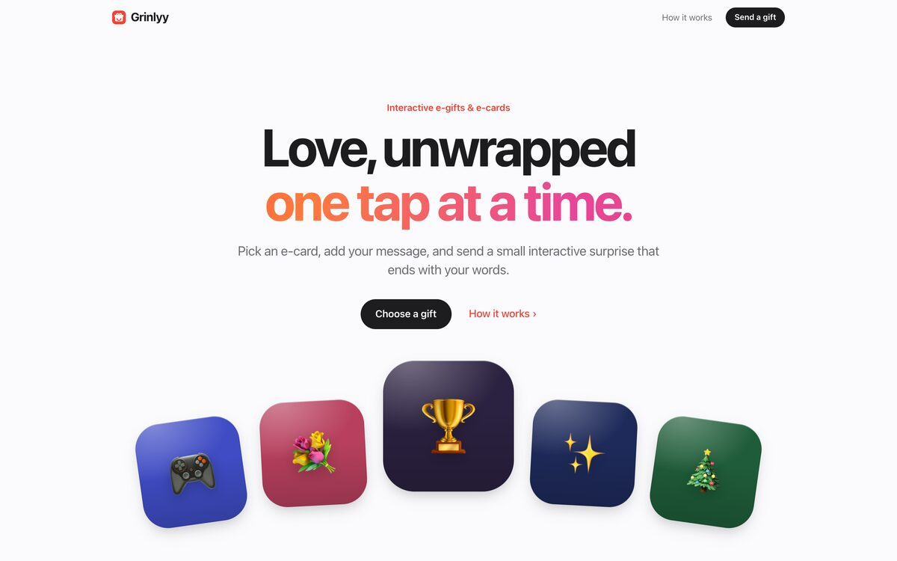
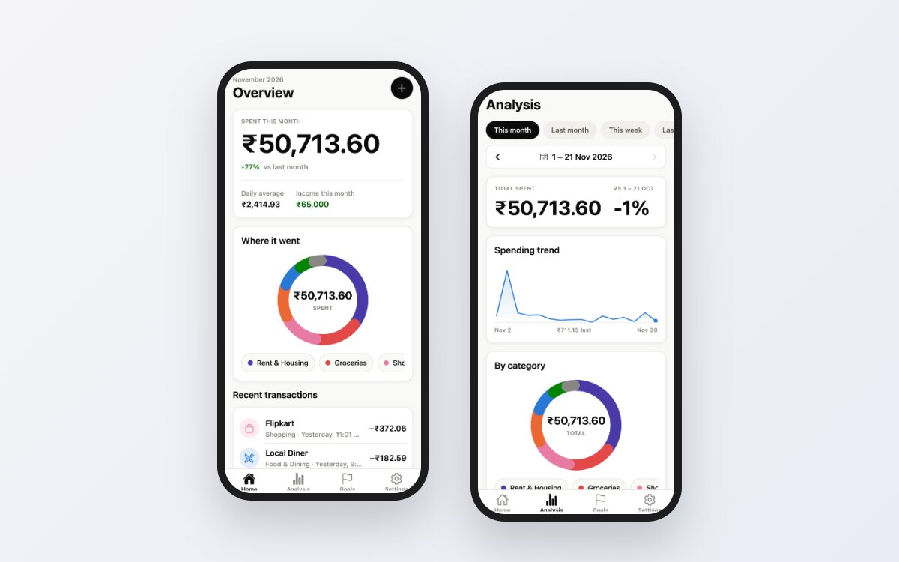

<a href="https://paraskumarsoni.com">
  <picture>
    <source media="(prefers-color-scheme: dark)" srcset="assets/header-dark.svg">
    
  </picture>
</a>

 

I've spent seven years on the parts of products that have to hold up under load, like JioHotstar's ads during IPL and the shared libraries MakeMyTrip's apps are built on. These days I'm at ServiceNow, working on platform architecture and performance for enterprise workspaces.

Outside work I build my own products, end to end. A few of them are below.

**[Portfolio](https://paraskumarsoni.com)** · **[LinkedIn](https://www.linkedin.com/in/soniparas/)** · **[Resume](https://paraskumarsoni.com/Paras_Kumar_CV.pdf)** · **[Email](mailto:kumarparas249@gmail.com)**

 

## What I've built

<table>
  <tr>
    <td width="33%" valign="top">
      
      <h3><a href="https://grinlyy.com">Grinlyy</a></h3>
      E-cards people actually play with. Pop a piñata or shake a snow globe, and your note shows up at the end. 60+ designs, with payments and email delivery.
        
      Next.js · Postgres (Supabase) · Razorpay · Resend
    </td>
    <td width="33%" valign="top">
      
      <h3><a href="https://rentmaps.xyz">RentMaps</a></h3>
      Real rents on a map, posted anonymously by renters and owners. No brokers, no sign-up. Running in cities across six countries.
        
      Next.js · MapLibre GL · Turso (SQLite) · Telegram alerts
    </td>
    <td width="33%" valign="top">
      
      <h3><a href="https://expense-tracker-web-henna-omega.vercel.app">Expense Tracker</a></h3>
      Reads bank and UPI SMS on the phone, pulls out the amount and merchant, and asks you to confirm with one tap. In progress, and I use it every day.
        
      React Native · native SMS module · FastAPI · Postgres
    </td>
  </tr>
</table>

 

## Where I've worked

| Company | Role | What I did |
|---|---|---|
| **ServiceNow** | Senior Software Engineer 2025 – now | Re-architecting core platform features into reusable, framework-agnostic components. Daily performance work for enterprise customers like DHL. |
| **JioHotstar** | Senior Software Engineer 2024 – 25 | Owned the Ads SDK module across web, mobile web and TV. 20M+ ad impressions a day through IPL; midroll ads on TV raised revenue share by 17%. |
| **MakeMyTrip** | Software Engineer II 2022 – 24 | One shared library for every brand's web and mobile apps (QA and dev 50% faster), plus a shared business-logic layer that cut dev time by 30%. |
| **Fewcents** | Software Engineer 2021 – 22 | Stripe checkout with 100+ currencies that doubled conversion, and the script that decides between a tip jar and a paywall (+25% revenue). |
| **IBM** | Application Developer 2019 – 21 | Rewrote a legacy ActionScript app covering 160+ AT&T product catalogs in React, and made it 20% faster. |

 

## What I work with

**Systems** · system design (LLD / HLD), SDKs, shared libraries, caching, performance profiling 
**Languages** · TypeScript, JavaScript, Python 
**Back end** · REST APIs, Next.js API routes, FastAPI, Postgres, MySQL, MongoDB 
**Platforms** · web, mobile (React Native), TV 
**Delivery** · CI/CD, Docker, Jest, Playwright, Sentry, Vercel 
**AI** · agentic workflows, RAG, prompt engineering

 

Most of my side projects are private while they're in progress. If you'd like to see the code for one, just ask.
